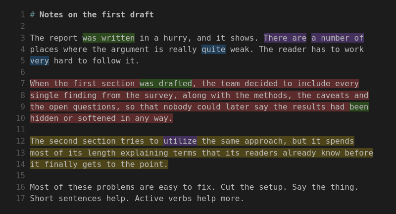

# vimingway.nvim

Hemingway-style highlights for [Vale](https://vale.sh) in Neovim.

Vale's alerts in Neovim are underlines. The Hemingway Editor colors the text
itself, which makes problems easier to spot while reading a draft. Vimingway
adds those colors on top of the underlines.

<picture>
  <source media="(prefers-color-scheme: light)" srcset="assets/screenshot-light.png">
  
</picture>

The text in the screenshot is [`assets/demo.md`](assets/demo.md).

| Color | Meaning | Vale rules |
|-------|---------|------------|
| Yellow | Hard-to-read sentence | `Vimingway.HardSentence` (over 25 words) |
| Red | Very hard sentence | `Vimingway.VeryHardSentence` (over 35 words) |
| Purple | A simpler word or phrase exists | `write-good.TooWordy`, `write-good.ThereIs`, `proselint.Needless`, `Voices.ColonReveal`, `Voices.ThroatClearing` |
| Blue | Adverbs and weakeners | `write-good.Weasel`, `proselint.Very` |
| Green | Passive voice | `write-good.Passive` |

Hemingway's purple is for wordy phrases. Vimingway also uses it for openers
that delay the point: "There is/are" sentences, colon reveals ("Summed up:
a…") and throat-clearing ("Here's the thing"). The fix is the same: cut the
setup and say the thing.

Other alerts, like spelling, keep only their underlines.

The repo has two parts:

- **The Neovim plugin**, which draws the colors.
- **A Vale style**, `Vimingway`, with the two sentence-length rules. It works
  without the plugin, in any editor or on the command line.

## Requirements

- Neovim 0.10 or later
- [Vale](https://vale.sh/docs/install), run through either
  [vale-ls](https://github.com/errata-ai/vale-ls) (as a language server) or
  [nvim-lint](https://github.com/mfussenegger/nvim-lint)'s `vale` linter

## Install

### The Vale style

Add the packages to your `.vale.ini`, then run `vale sync`:

```ini
StylesPath = .vale/styles
MinAlertLevel = suggestion
Packages = write-good, proselint, https://github.com/MikeWilsonSTL/vimingway.nvim/releases/latest/download/Vimingway.zip

[*.md]
BasedOnStyles = Vale, write-good, proselint, Vimingway
```

The purple rules from [Voices](https://github.com/errata-ai/Voices) are
optional. If you add it, use `[*.{md,mdx,txt}]` as the section name, the same
pattern Voices uses. With plain `[*.md]`, Vale uses only Voices' section and
drops the styles in yours.

### The plugin

With [lazy.nvim](https://github.com/folke/lazy.nvim):

```lua
{
  "MikeWilsonSTL/vimingway.nvim",
  cmd = "Vimingway",
  keys = {
    { "<leader>tw", "<cmd>Vimingway<cr>", desc = "Toggle Vimingway highlights" },
  },
  opts = {},
}
```

Any plugin manager works. Vimingway sets itself up with the defaults the first
time you run `:Vimingway`, so calling `setup()` is only needed to change
options.

## Use

| Command | Does |
|---------|------|
| `:Vimingway` | Turn the colors on or off |
| `:Vimingway on` / `:Vimingway off` | Turn them on or off |

The colors start off. They're most useful while editing a draft; a page of
colored backgrounds is distracting while you write it. They follow your edits,
redrawing each time Vale reports new alerts.

From Lua: `require("vimingway").toggle()`, `.enable()`, `.disable()` and
`.is_enabled()`.

## Options

These are the defaults:

```lua
require("vimingway").setup {
  enabled = false, -- start with the colors on
  notify = true, -- show "Vimingway on/off" when toggling
  sources = { "vale-ls", "vale" }, -- diagnostic sources to read
  -- Vale rule name -> color. Kinds: hard, very_hard, complex, adverb, passive.
  -- Your table merges into this one; set a rule to false to drop it.
  rules = {
    ["Vimingway.HardSentence"] = "hard",
    ["Vimingway.VeryHardSentence"] = "very_hard",
    ["write-good.TooWordy"] = "complex",
    ["write-good.ThereIs"] = "complex",
    ["proselint.Needless"] = "complex",
    ["Voices.ColonReveal"] = "complex",
    ["Voices.ThroatClearing"] = "complex",
    ["write-good.Weasel"] = "adverb",
    ["proselint.Very"] = "adverb",
    ["write-good.Passive"] = "passive",
  },
  -- Background colors, picked by 'background'. false leaves the highlight
  -- groups to your color scheme.
  palette = {
    light = { hard = "#f7ecb5", very_hard = "#e4b9b9", complex = "#dccde8", adverb = "#c4e3f3", passive = "#c4ed9d" },
    dark = { hard = "#4d4419", very_hard = "#5c2b2b", complex = "#43305c", adverb = "#1f3d57", passive = "#2d4a1f" },
  },
  -- Words with a period that don't end a sentence (lowercase).
  abbreviations = { "e.g.", "i.e.", "vs.", "cf.", "mr.", "mrs.", "ms.", "dr." },
}
```

The light palette is close to Hemingway's own colors. The dark one uses the
same hues, darkened so light text stays readable on them.

The highlight groups are `VimingwayHard`, `VimingwayVeryHard`,
`VimingwayComplex`, `VimingwayAdverb` and `VimingwayPassive`.

## How it works

Every Vale diagnostic carries its rule name in its `code` field, like
`write-good.Passive`. On each `DiagnosticChanged` event, Vimingway keeps the
diagnostics from Vale whose rule is in `rules`, then redraws them as extmarks
with a background color.

Where colors overlap, word colors sit above sentence colors, so a passive
phrase inside a long sentence shows green on yellow. Red sits above yellow
for sentences that trip both rules.

Vale marks a long sentence by its first character only. To color the whole
sentence, Vimingway walks forward to the first `.`, `!` or `?` followed by a
space or the end of the line, including any closing quotes and brackets. It
skips the `abbreviations`, and stops at the end of the paragraph if it gets
there first. An abbreviation that isn't in the list, like "approx.", still
ends the color early.

## The sentence rules

Hemingway's formula isn't public, so the two rules just count words:

```yaml
extends: occurrence
message: "Long sentence (more than 25 words). Consider splitting it."
level: suggestion
scope: sentence
max: 25
token: \b(\w+)\b
```

`VeryHardSentence` is the same with `max: 35` and level `warning`. To make
them stricter or looser, copy them into your own style and change `max`.
Contractions count as two words ("I've" is "I" and "ve"), so the counts run
slightly high.

## Development

```sh
nvim --headless -u NONE -l tests/run.lua
```

Pushing a `v*` tag builds `Vimingway.zip` and attaches it to a GitHub
release.

## License

MIT
